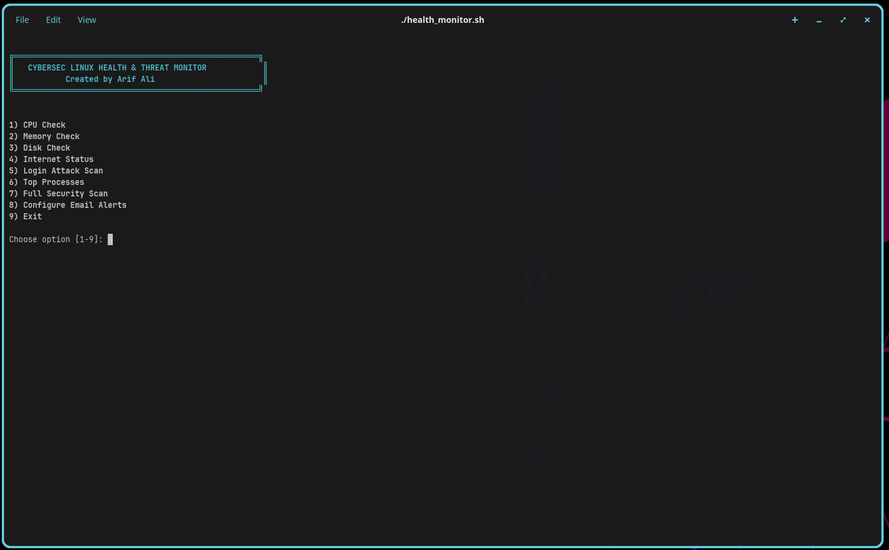
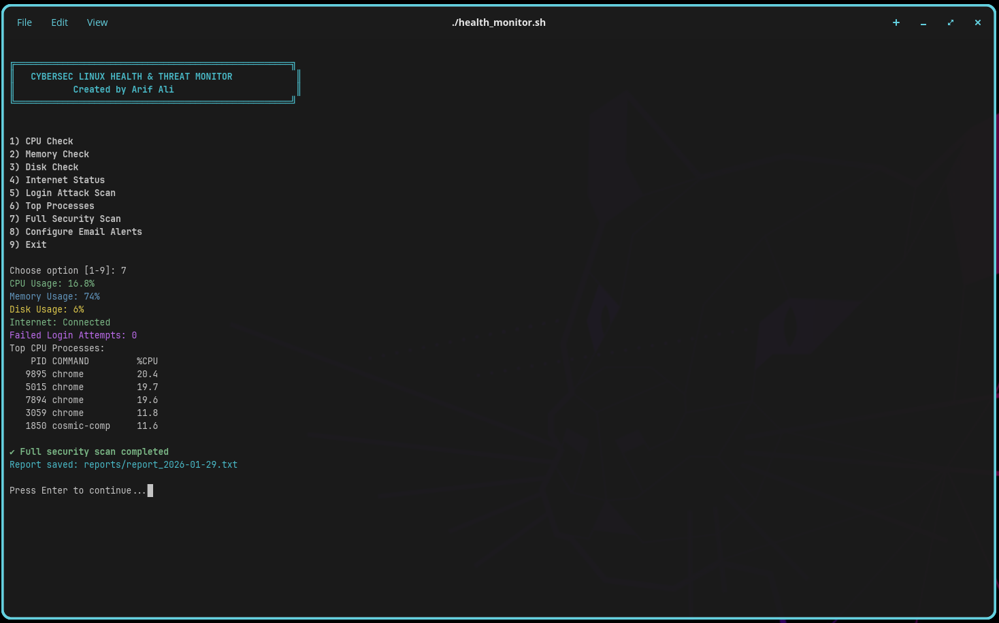

# 🛡️ CyberSec Linux SOC & Health Monitor (`CyberSecMon`)

<p align="center">
  
  <a href="https://github.com/ArifAli8866/linux-soc-monitor/actions/workflows/ci.yml"></a>
  <a href="LICENSE"></a>
  
  <a href="https://linkedin.com/in/arif-ali-23a38032a"></a>
</p>

<p align="center">
  <strong>Lightweight, Modular Linux Security Operations Center (SOC) & Host Health Monitoring Suite</strong>
</p>

---

## 📌 Overview

**CyberSecMon** (CyberSec Linux Health & Threat Monitor) is an enterprise-grade yet lightweight Linux security monitoring tool. Built entirely in native Bash without heavy runtime dependencies, it bridges the gap between terminal dashboards and automated SOC pipelines.

Whether run interactively as a menu-driven TUI, automated through `cron` or `systemd`, or integrated into modern SIEM platforms via structured JSON telemetry, **CyberSecMon** delivers immediate threat visibility and resource governance.

---

## ✨ Features

- 📊 **Resource & Health Governance**: Live metrics for CPU, RAM, and disk utilization with configurable alert thresholds.
- 🚨 **Brute-Force Detection**: Monitors `/var/log/auth.log`, `/var/log/secure`, and `journalctl` for failed authentication attacks.
- 🌐 **Attack Surface & Open Ports Audit**: Audits listening TCP/UDP sockets (`ss`/`netstat`) and raises critical alerts for sensitive database ports (Redis, MySQL, Postgres, Mongo) exposed on `0.0.0.0`.
- 👤 **Identity & Privilege Auditing**: Tracks active terminal sessions, scans `/etc/passwd` for unauthorized UID 0 superuser accounts, and audits interactive shell accounts.
- ⚙️ **System Integrity & Services**: Detects failed systemd service units, audits firewall status (UFW / iptables), and scans `/etc/cron*` for unauthorized scheduled task persistence.
- 📡 **SIEM-Ready JSON Telemetry**: Export complete system state as machine-readable JSON via `--json` for ingestion into Splunk, Elastic, or Wazuh.
- 🔄 **Daemon & Headless Modes**: Non-interactive continuous monitoring with customizable scan intervals (`--daemon`).
- 📧 **Automated Email Notifications**: Dispatches alerts when critical thresholds or security events occur.
- 🛠️ **Multi-Distro Installer**: Automated setup for Ubuntu, Debian, Fedora, CentOS/RHEL, Arch Linux, and openSUSE.

---

## 📐 Architecture & Workflow

```
┌────────────────────────────────────────────────────────┐
│      CyberSec Linux Health & Threat Monitor (CLI/TUI)  │
└───────────────────────────┬────────────────────────────┘
                            │
       ┌────────────────────┼────────────────────┐
       ▼                    ▼                    ▼
┌──────────────┐     ┌──────────────┐     ┌──────────────┐
│ Host Health  │     │ Threat Intel │     │  Integrity   │
├──────────────┤     ├──────────────┤     ├──────────────┤
│ • CPU Usage  │     │ • Brute-Force│     │ • Failed Svcs│
│ • RAM Usage  │     │ • Open Ports │     │ • UID 0 Root │
│ • Disk Usage │     │ • Exposed DBs│     │ • Cron Tasks │
│ • Network OK │     │ • Active User│     │ • Firewall   │
└──────┬───────┘     └──────┬───────┘     └──────┬───────┘
       │                    │                    │
       └────────────────────┼────────────────────┘
                            │
       ┌────────────────────┴────────────────────┐
       ▼                                         ▼
┌──────────────┐                          ┌──────────────┐
│ Alert Engine │                          │  Reporting   │
├──────────────┤                          ├──────────────┤
│ • Email Mail │                          │ • Text Logs  │
│ • Local Logs │                          │ • JSON Tele. │
└──────────────┘                          └──────────────┘
```

---

## 🚀 Quick Start & Installation

### Option 1: Automated System Installation (Recommended)

Clone the repository and run the automated installer with `sudo`:

```bash
git clone https://github.com/ArifAli8866/linux-soc-monitor.git
cd linux-soc-monitor
chmod +x install.sh
sudo ./install.sh
```

The installer:
1. Detects your distribution and installs dependencies (`mailutils`, `iputils-ping`, `procps`, etc.).
2. Installs the binary to `/usr/local/bin/cybersecmon`.
3. Sets up system configuration at `/etc/cybersec_monitor.conf`.
4. Installs the systemd unit `cybersecmon.service`.

### Option 2: Portable / Standalone Execution

You can run the script directly without installing globally:

```bash
git clone https://github.com/ArifAli8866/linux-soc-monitor.git
cd linux-soc-monitor
chmod +x health_monitor.sh
./health_monitor.sh
```

---

## 💻 Usage & CLI Options

### Interactive Menu Mode
Simply execute without arguments to launch the colorful dashboard:
```bash
cybersecmon
```

```
╔════════════════════════════════════════════════════╗
║   CYBERSEC LINUX HEALTH & THREAT MONITOR            ║
║           Created by Arif Ali                       ║
╚════════════════════════════════════════════════════╝

1)  CPU Check
2)  Memory Check
3)  Disk Check
4)  Internet Status
5)  Login Attack Scan
6)  Top Processes
7)  Open Ports & Sockets Audit
8)  User Accounts & Sessions Audit
9)  System Integrity & Services Audit
10) Full Security Scan
11) Configure Settings & Thresholds
12) Exit
```

### CLI Command-Line Flags

```bash
# Display help and usage
cybersecmon --help

# Display version
cybersecmon --version

# Run single non-interactive scan (ideal for crontabs)
cybersecmon --scan

# Output structured JSON telemetry (ideal for SOC pipelines)
cybersecmon --json

# Run continuously as daemon with 60-second intervals
cybersecmon --daemon 60

# Specify custom configuration file
cybersecmon --config /path/to/custom.conf

# Skip automatic dependency verification
cybersecmon --no-install --scan
```

---

## 📊 SIEM / JSON Telemetry Sample

Running `cybersecmon --json` produces structured JSON output:

```json
{
  "timestamp": "2026-10-13 23:50:00",
  "system": {
    "hostname": "linux-server",
    "kernel": "6.18.7-generic"
  },
  "metrics": {
    "cpu_percent": 18.4,
    "memory_percent": 62,
    "disk_percent": 45,
    "internet_status": "connected",
    "failed_logins": 0,
    "listening_ports_count": 14,
    "failed_systemd_units": 0
  },
  "thresholds": {
    "cpu_limit": 80,
    "memory_limit": 80,
    "disk_limit": 85,
    "login_fail_limit": 5
  }
}
```

---

## ⚙️ Configuration

Configurations are stored in `~/.config/cybersec_monitor/cybersec_monitor.conf` (user mode) or `/etc/cybersec_monitor.conf` (system mode).

```ini
# CyberSec Linux Health & Threat Monitor Config
EMAIL_ALERT="security-team@example.com"
CPU_LIMIT=80
MEM_LIMIT=80
DISK_LIMIT=85
LOGIN_FAIL_LIMIT=5
REPORT_DIR="reports"
LOG_FILE="security.log"
```

You can update configurations directly via **Option 11** in the menu or by using a custom config via `--config`.

---

## 🔄 Systemd Background Service

Run `CyberSecMon` as a background persistent daemon managed by systemd:

```bash
# Enable and start the service
sudo systemctl enable --now cybersecmon

# Check service status
sudo systemctl status cybersecmon

# View live service logs
sudo journalctl -u cybersecmon -f
```

---

## 🧪 Automated Testing & CI

A comprehensive test suite is included in `tests/test_monitor.sh`. To run tests locally:

```bash
./tests/test_monitor.sh
```

GitHub Actions automatically runs syntax verification and unit tests on every commit and pull request.

---

## 🖼️ Screenshots

<p align="center">
  
  
</p>

---

## 🗑️ Uninstallation

To cleanly remove `CyberSecMon` and its systemd service:

```bash
sudo ./uninstall.sh
```

---

## 📄 License

This project is open-source and distributed under the [MIT License](LICENSE).

---

## 👤 Author & Support

Developed by **Arif Ali**  
- **GitHub**: [@ArifAli8866](https://github.com/ArifAli8866)  
- **LinkedIn**: [Arif Ali](https://linkedin.com/in/arif-ali-23a38032a)  
- **Repository**: [linux-soc-monitor](https://github.com/ArifAli8866/linux-soc-monitor)
